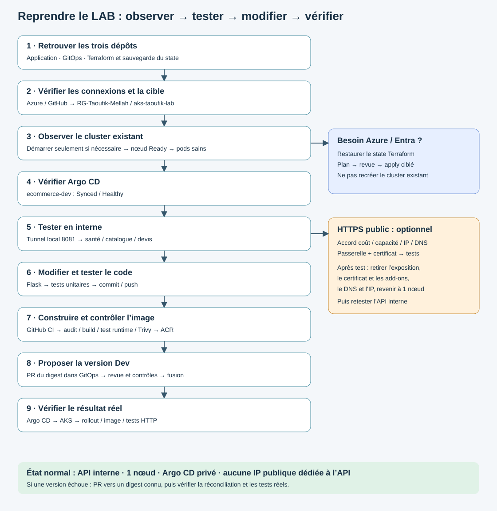
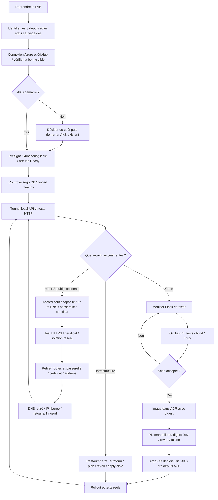

# Reprendre le LAB après une pause

Ce guide sert à retrouver l’existant avant de modifier quoi que ce soit.
Le parcours normal utilise une API interne en HTTP, accessible par un tunnel
local. Le test HTTPS public est optionnel, coûte plus cher et doit être retiré
après usage. L’application est une API de démonstration, pas une boutique web.

## 1. Retrouver les trois parties

| Dépôt | Rôle | Point de départ |
|---|---|---|
| platform-infra | Ressources Azure/Entra et droits déclarés dans Terraform | environments/lab/main.tf |
| platform-gitops | Argo CD, frontières Kubernetes, déploiements et images désirées | applications/dev.yaml puis apps/ecommerce/overlays/dev |
| ecommerce-app | API Flask, tests, image Docker, pipeline applicatif | app.py puis .github/workflows/ci.yaml |

Les fichiers vendor sont des fichiers officiels figés, non réécrits. Les commentaires
expliquent les adaptations dans les fichiers qui les entourent. Les fichiers state,
.tfvars, kubeconfig, clés privées et .env ne doivent jamais être publiés.

Dans l’espace de travail initial, les sources sont à la racine gitops/ et les
copies Git autonomes dans .local/repos/. Les commandes ci-dessous indiquent le
contexte : ne pas confondre un chemin de source avec le clone Git à publier.
Les docs copiées dans platform-gitops utilisent les scripts autonomes de ce dépôt.

## 2. Vérifier les connexions et la cible

Depuis le dépôt platform-gitops, ou la racine initiale gitops/ :

```bash
az account show --query '{subscription:id,user:user.name}' -o json
gh auth status
az aks show -g RG-Taoufik-Mellah -n aks-taoufik-lab \
  --query '{power:powerState.code,state:provisioningState}' -o json
```

Si nécessaire, se reconnecter avec `az login` et `gh auth login`, puis sélectionner
la bonne souscription avec `az account set --subscription <ID>`. Ne pas copier les
tokens dans le chat ou Git. La cible est le cluster existant aks-taoufik-lab dans
RG-Taoufik-Mellah : ne pas lancer de création de cluster.

Si le cluster est Stopped, décider de reprendre sa facturation avant :

```bash
az aks start -g RG-Taoufik-Mellah -n aks-taoufik-lab
```

Le script preflight ne démarre pas un cluster arrêté à ta place.

## 3. Contrôler l’existant avant tout apply

```bash
source scripts/kubeconfig.sh
bash scripts/preflight.sh
kubectl config current-context
kubectl get nodes
kubectl get pods -A
kubectl -n argocd get applications
kubectl -n ecommerce-dev get deployment,pods,svc
```

Attendre le nœud Ready, l’API disponible et ecommerce-dev Synced/Healthy.
Pending indique souvent un manque de capacité ; CrashLoopBackOff impose de lire
les événements et logs. Ne pas redémarrer tous les pods ou augmenter les VM sans
comprendre la cause et le coût.

L’état normal attendu : un nœud, Service ecommerce-api en ClusterIP, aucune route
publique de notre test, pas de passerelle publique ni cert-manager du test.
L’API Kubernetes AKS reste un endpoint public d’administration ; « sans IP »
signifie sans l’IP additionnelle de l’API applicative. AKS conserve ses ressources
réseau techniques et son Load Balancer sortant partagé.

## 4. Tester l’API interne

Terminal 1, avec le kubeconfig isolé :

```bash
source scripts/kubeconfig.sh
kubectl -n ecommerce-dev port-forward --address 127.0.0.1 service/ecommerce-api 8081:80
```

Terminal 2 :

```bash
curl --fail http://127.0.0.1:8081/healthz
curl --fail http://127.0.0.1:8081/api/products
curl --fail -H 'Content-Type: application/json' \
  --data '{"items":[{"product_id":"keyboard","quantity":2},{"product_id":"mouse","quantity":1}]}' \
  http://127.0.0.1:8081/api/quotes
```

Attendu : santé ok, trois produits, total 12300 centimes EUR. HTTP est ici dans
un tunnel local kubectl ; ne pas rendre ce port accessible sur 0.0.0.0.
Ctrl+C coupe seulement le tunnel, pas l’application.

## 5. Ouvrir Argo CD

Dans un autre terminal :

```bash
source scripts/kubeconfig.sh
kubectl -n argocd port-forward --address 127.0.0.1 service/argocd-server 8080:443
```

Ouvrir https://localhost:8080 et choisir Microsoft Entra ID. Le certificat local
Argo CD peut produire un avertissement du navigateur. Ne pas confondre ce TLS
local d’administration avec le certificat public de l’API, retiré après test.
Le port 8080 correspond à la redirection SSO configurée : ne pas changer le port
sans adapter aussi la configuration de redirection.

## 6. Comprendre le chemin d’une modification

1. Modifier ecommerce-app/app.py et lancer les tests dans ce dépôt.
2. Commit/push : GitHub teste, audite, construit et teste le runtime, puis Trivy
   bloque les images HIGH/CRITICAL avant ACR. Un push main peut créer une image.
3. Lire les résultats CI avant promotion ; garder le digest sha256, pas un tag
   mutable seul. Le pipeline ne possède aucun kubeconfig ni droit de déploiement.
4. Proposer ce digest dans une PR du seul overlay Dev de platform-gitops.
   La GitHub App de promotion automatique reste à configurer : faire cette PR
   manuellement tant que ENABLE_GITOPS_PR n’est pas activé avec ses identifiants.
5. Après revue et contrôles, fusionner ; Argo CD réconcilie main automatiquement
   pour Dev (selfHeal, pas de prune automatique).
6. Vérifier rollout, image réellement exécutée et requêtes HTTP. Un job CI vert
   ne prouve pas que le pod AKS exécute déjà le digest attendu.
7. En cas d’erreur, proposer une PR restaurant un digest connu et vérifier le
   retour réel. Ne pas corriger durablement l’image par kubectl set image : Git
   resterait différent et selfHeal pourrait annuler la modification.

```bash
# Dans ecommerce-app (environnement Python virtuel conseillé)
python -m unittest discover -s tests -v
# Dans platform-gitops
bash scripts/platform.sh render
bash scripts/argocd.sh render
kubectl -n ecommerce-dev rollout status deployment/ecommerce-api --timeout=120s
kubectl -n ecommerce-dev get deployment ecommerce-api \
  -o jsonpath='{.spec.template.spec.containers[0].image}{"\n"}'
```

Staging et Prod sont des overlays préparés avec promotions manuelles. Ne pas
appliquer toutes les Applications ou un kustomize récursif sans choisir la cible.

## 7. Terraform : quand et comment le reprendre

Seulement pour une modification Azure/Entra, pas pour changer le code ou l’image.
Dans platform-infra :

```bash
bash scripts/terraform-lab.sh init
bash scripts/terraform-lab.sh validate
bash scripts/terraform-lab.sh plan
```

L’état est local et sensible : `$HOME/.local/state/taoufik-gitops/lab/terraform.tfstate`.
Sur une nouvelle machine, RESTAURER cet état de façon sécurisée avant plan/apply.
Ne pas initialiser un état vide pour des ressources existantes : cela proposerait
leur recréation. Les import blocks SSO ne remplacent pas la sauvegarde complète.
Lire les créations/modifications/suppressions du plan ; appliquer uniquement le
plan revu. Les scripts ne lancent pas terraform apply automatiquement.
AKS est lu par data source : son nombre de nœuds et l’activation des add-ons
ne sont pas gérés par ce Terraform actuel.

## 8. Expérience HTTPS optionnelle, pas le démarrage normal

Lire platform/public-api/README.md. Avant réactivation : prévoir la capacité
(deux Standard_D2s_v5 avaient été nécessaires), le coût, une IP créée via Terraform,
le rôle réseau à cette IP, un DNS exact et une autorisation pour les add-ons.
Une IP supprimée n’est pas garantie de revenir identique : mettre à jour le DNS
avec la NOUVELLE adresse. Ne jamais réutiliser aveuglément 51.103.104.29.

Le script public-api.sh apply installe des composants persistants et publie l’API.
Render n’applique rien. L’expérience était fonctionnelle avant son retrait ;
elle ne doit pas être réactivée automatiquement lors d’une simple reprise.

## Schéma du parcours



[Ouvrir le schéma SVG](parcours-lab.svg)




## Ce qu’il faut retenir

Commencer par observer et tester l’existant. Terraform décrit l’infrastructure,
Git décrit la version à déployer, Argo CD applique Git, ACR stocke les images.
Ne jamais tout réinstaller pour simplement rouvrir le LAB. Une application
fonctionnelle en interne n’a besoin ni d’IP publique dédiée ni de Gateway.
